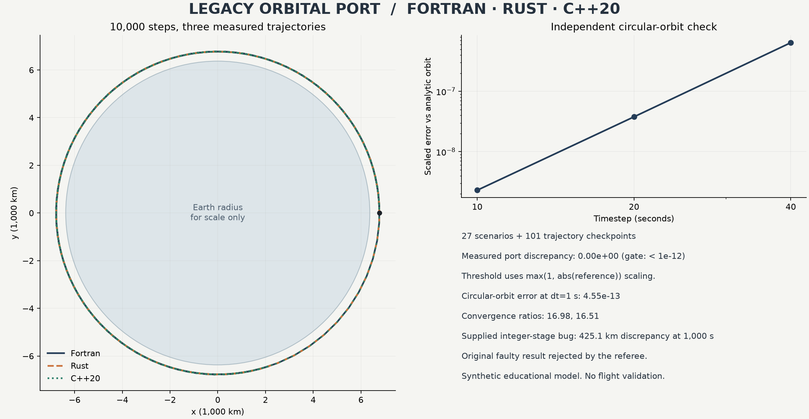

# Legacy Orbital Port

[](https://github.com/vanovri/legacy-orbital-port/actions/workflows/verify.yml)

A small, reproducible numerical migration lab: a corrected legacy-style Fortran
RK4 orbit solver, a safe Rust port, a C++20 port, and a Python referee that compiles
and runs all three. It catches an actual implicit-integer defect in the supplied
example before using the corrected reference for differential verification.



The original source is synthetic educational code, not authenticated 1960s software.
See [provenance and the reference correction](PROVENANCE.md).

## Run

Requirements: Python 3.10+, GNU Fortran, GCC C++ with C++20 support, and Rust 2021.
The referee and solvers have no third-party package dependencies.

```sh
python3 -m unittest discover -s tests -v
python3 verify_parity.py
python3 verify_parity.py --profile checked
```

On Windows, use an installed WSL distribution with the Linux toolchains, or install
native GNU/Rust toolchains on PATH and use `python`. Example with WSL Ubuntu:

```powershell
wsl -d Ubuntu-26.04 -- bash -lc 'cd /mnt/c/Users/ardhy/Projects/legacy-orbital-port && python3 verify_parity.py'
```

`FC`, `CXX`, and `RUSTC` may point to individual compiler executables. Optimized mode
uses `-O2` and disables floating-point contraction/fast-math for GNU solvers. Checked
mode enables GNU Fortran runtime/FPE checks, C++ undefined-behavior/bounds sanitizers,
and Rust debug/overflow checks. The checked C++ mode requires GCC sanitizer support.
Actual commands' flags and compiler versions are recorded in each JSON report.

Optional, regenerate the figure from a successful measured report:

```sh
python -m pip install -r tools/requirements-plot.txt
python tools/plot_report.py reports/verification-optimized.json
```

## What is verified

- 27 deterministic scenarios: 0/1/10/100/1,000/10,000-step checkpoints, circular,
  retrograde, eccentric, force-free, dimensionless, and 16 seeded off-axis states.
- A further 101 sampled trajectory states over 10,000 seconds, comparing all ports.
- Strict scaled component error below `1e-12` against the corrected Fortran result.
- Closed-form circular orbit and force-free drift, energy/angular momentum drift,
  and approximately fourth-order convergence when halving the timestep.
- Repeated/default-run agreement, malformed input and singularity rejection, and
  an executable negative control using the supplied integer-stage defect.
- Ten unit tests attacking the referee's output shape, finite-number checks,
  threshold boundary, scaling, wrong units/sign, and deterministic scenario seed.

The metric is `max_i(abs(reference_i - candidate_i) / max(1, abs(reference_i)))`.
Near zero this is an absolute tolerance. It is not a pure relative tolerance, an
ULP bound, or a guarantee of bitwise identity across compilers and hardware.

The reports in [reports/](reports/) contain measured results, compiler/source hashes,
the rejected original result, the corrected result, and replayable trajectory data.
A failed run exits nonzero and replaces its destination report with `status: failed`.

## Solver contract

With empty stdin each executable runs 10,000 one-second steps from
`(x,y,vx,vy) = (6778137,0,0,7668.6)` with `gm = 3.986004418e14`.
Optional input is one line of seven whitespace-separated values:

```text
steps dt gm x y vx vy
```

Example, after running the referee to compile:

```sh
printf '10000 1 3.986004418e14 6778137 0 0 7668.6\n' | build/optimized/orbital_rust
```

Units: seconds, meters, meters per second, and `gm` in cubic meters per square
second. `steps` is an integer from 0 to 1,000,000; `0 < dt <= 60`; `0 <= gm <= 1e20`.
All inputs must be finite. Use a short numeric record below 512 characters for the
Fortran driver. Output is exactly four finite values, `x y vx vy`. Invalid input or
an unrepresentable/singular evaluation returns a nonzero process code. Codes and
diagnostic wording are not a cross-language API contract.

## Model limits

This is a two-dimensional, central point-mass Newtonian model with fixed-step RK4.
It excludes drag, Earth shape, J2, other bodies, atmosphere, collision detection,
adaptive timesteps, relativistic effects, and mission-grade propagation. Timestep
validation bounds runtime, not the physical or numerical suitability of every
possible input. Energy/convergence checks apply to the tested scenarios.

This project does not substantiate a Gemini output limit, Google's benchmark
numbers, an autonomous historical migration, or production flight readiness.
[AGENT_GOAL_PROMPT.md](AGENT_GOAL_PROMPT.md) is an optional bounded migration prompt,
not a record of an agent run.

## Files

| File | Purpose |
| --- | --- |
| `legacy_orbital.f` | Corrected fixed-form COMMON/GOTO reference and checked driver |
| `orbital_solver.rs` | Struct-based Rust port with unsafe code forbidden |
| `orbital_solver.cpp` | Struct-based C++20 port without raw pointer arithmetic |
| `verify_parity.py` | Compiler orchestration, independent oracles, reports |
| `tests/fixtures/supplied_implicit_integer.f` | Uncorrected user-supplied regression fixture |
| `tests/test_referee.py` | Acceptance-gate negative controls |
| `tools/plot_report.py` | Optional Matplotlib figure generation from measured JSON |

## License

MIT. Created by Ardhya Novri Ramadhan with AI-assisted development and explicit
numerical verification. Compiler and standard-library implementations are separate
dependencies with their own licenses.
